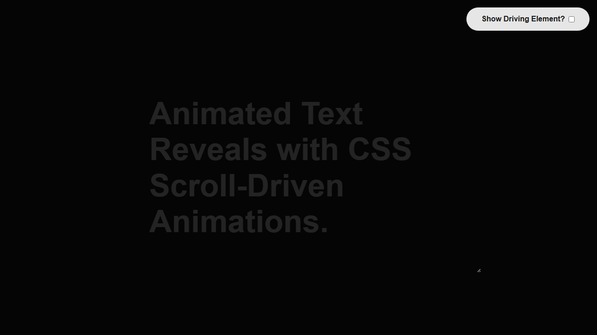

# Text-Reveal

**Live demo:** https://chandrasen74.github.io/Text-Reveal/  
**Repository:** https://github.com/Chandrasen74/Text-Reveal



## Overview
`Text-Reveal` is a HTML/CSS project.
- **Primary language:** CSS
- **Languages detected:** HTML, CSS
- **Stack/tech:** HTML, CSS
- **Entry point:** `index.html`
- **Key files:** `index.html`

## Language & stack details
- Languages: HTML, CSS
- Frameworks/tools/libraries: HTML, CSS

## How to install & run
### Prerequisites
- A modern web browser
- (Optional) [Python 3](https://www.python.org/) or any static file server for local serving

### Run locally
```bash
git clone https://github.com/Chandrasen74/Text-Reveal.git
cd Text-Reveal
```
- **Option 1:** open `index.html` directly in your browser
- **Option 2:** serve locally (recommended for some JS features):
```bash
python -m http.server 8000
# then open http://localhost:8000
```

## Repository structure (top-level/sample)
- `README.md`
- `index.html`
- `screenshot.png`
- `style.css`

## Status
Documented with screenshot, language/stack details, and setup instructions as part of a profile-wide README update.

## License

Copyright (c) 2026 Chandrasen. All rights reserved.

This repository is proprietary. No permission is granted to use, copy, modify, or distribute this code without prior written permission.
See [LICENSE](LICENSE).
